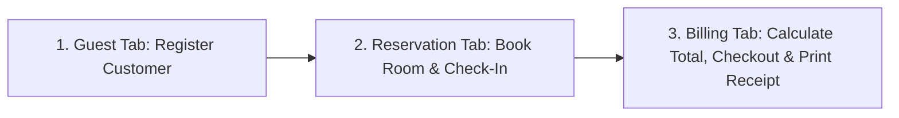

# HOTEL MANAGEMENT SYSTEM — CRISP EXPLANATION
## Module: Reservations, Guests & Billing (Member 2)

> **Use this version when**: You need to explain the system to a professor, examiner, or teammate in **2 to 3 minutes** using plain, confident, and professional language.

---

## 1. The 30-Second Elevator Pitch

> *"Our module is the core transactional engine of the Hotel Management System. It manages the entire customer lifecycle in 3 seamless steps:*
> 1. ***Guest Registration***: *Capturing personal details and verified ID proofs.*
> 2. ***Room Reservation***: *Booking rooms, managing stay dates, and checking in guests.*
> 3. ***Billing & Checkout***: *Automatically computing room charges based on nights stayed, adding taxes and hotel services, and issuing a final printable invoice upon checkout.*
>
> *Everything is built using Java Swing for the graphical interface and MySQL for persistent database storage, following the clean Data Access Object (DAO) architecture."*

---

## 2. Walkthrough of What is on the Screen

Look at the main application window titled:  
**`Hotel Management System - Reservations, Guests & Billing`**

It contains **three dedicated tabs** located at the top:

```
[ Guest Management ]   |   [ Room Reservations ]   |   [ Billing & Checkout ]
```

### Tab 1: Guest Management (The Active Screen in the Screenshot)
- **Top Section — Guest Details Form**:
  - Contains fields for **Full Name**, **Phone**, **Email**, **ID Proof (Aadhaar / Passport)**, and **Address**.
  - When you click on any row in the table below (e.g., clicking on **Rahul Sharma**), his information automatically populates into these text fields so you can edit it.
- **Bottom Section — Guest Records Table**:
  - Displays all registered guests saved in our MySQL database.
  - Notice the columns: `ID | Full Name | Phone | Email | ID Proof | Address`.
  - As seen in our live database, we currently have guests:
    - ID 1: **Rahul Sharma** (Mumbai)
    - ID 2: **Ananya Patel** (Ahmedabad)
    - ID 4: **Aryan Patel** (Gujarat)
    - ID 5: **Ayan Bhatt** (Mumbai)
    - ID 12: **Ram Prasad** (Rajasthan)
- **Actions Available**:
  - **Add Guest**: Validates input and saves a new customer to MySQL with an auto-generated ID.
  - **Update Guest**: Modifies phone, email, or address for an existing guest without changing their ID number.
  - **Delete Guest**: Removes a guest profile (and cascades to remove their bookings).
  - **Clear / Refresh**: Resets text fields and reloads data from MySQL.

---

### Tab 2: Room Reservations (Booking & Check-In)
- **The Workflow**:
  1. The receptionist opens this tab and selects a guest from the dropdown (e.g., *Aryan Patel*).
  2. Selects an available room (e.g., *Room 201 — Executive Suite*). The nightly rate (₹4,500) automatically fills in.
  3. Picks check-in and check-out dates.
  4. Clicks **Book Room** $\rightarrow$ A new reservation is recorded with status `CONFIRMED`.
  5. When the guest physically arrives at the front desk, the receptionist selects the row and clicks **Check-In Guest** $\rightarrow$ Status transitions to `CHECKED_IN`.

---

### Tab 3: Billing & Checkout (The Financial Settlement)
- **The Workflow**:
  1. The receptionist selects the guest’s active stay from the dropdown.
  2. The system **automatically calculates stay duration and room charges** (e.g., 2 nights $\times$ ₹4,500 = ₹9,000).
  3. The receptionist enters any room service or food charges from Member 3's services (e.g., ₹500) and any promotional discount (e.g., ₹200).
  4. Selects the tax bracket (e.g., `12% GST`).
  5. The **Total Amount** recalculates in real-time.
  6. The receptionist selects payment method (Cash, Card, UPI) and clicks **Generate Bill & Checkout**:
     - The bill is recorded permanently in the database.
     - The reservation status automatically flips to `CHECKED_OUT`.
     - A formatted, printable **hotel receipt dialog** immediately pops up on screen showing the itemized invoice.

---

## 3. How the 3 Tabs Connect Together (The Golden Flow)



1. You **cannot book a room** without selecting a registered guest.
2. You **cannot generate a bill** without selecting an active reservation.
3. Checking out a guest **automatically marks their reservation as complete**, freeing the room for future bookings.

---

## 4. Key Takeaways to Speak in Viva

1. **Architecture**: *"We used a 3-tier architecture: Presentation (Swing UI), Data Access (DAO), and Data Model (POJO)."*
2. **Database Integrity**: *"The guest ID is the Primary Key. Reservations reference this ID as a Foreign Key. When updating a guest's info, their ID never changes to protect data integrity."*
3. **Financial Safety**: *"We use `BigDecimal` for currency and tax math to prevent decimal rounding errors, and database transactions (`commit`/`rollback`) to ensure billing and checkout succeed together atomically."*
