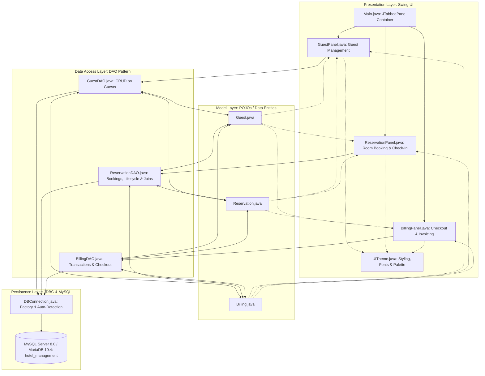
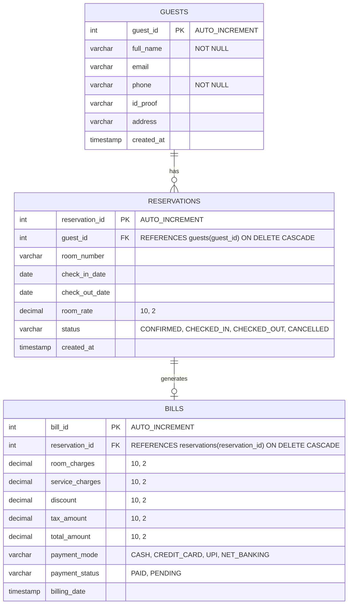

# HOTEL MANAGEMENT SYSTEM — DEEP ARCHITECTURAL GUIDE
## Module: Reservations, Guests & Billing (Member 2)

> **Use this version when**: You need to explain the system to an examiner, professor, senior engineer, or software architect. It covers system architecture, design patterns, library internals, database mechanics, and a file-by-file code walkthrough.

---

## 1. System & Solution Architecture

The module is engineered following the enterprise **3-Tier / Layered Architecture**:



### Why This Architecture?
1. **Separation of Concerns (SoC)**:
   - The UI classes only concern themselves with buttons, labels, and event handling.
   - The DAO classes only concern themselves with executing SQL and mapping results.
   - The Model classes only hold structured data in memory.
2. **Decoupled Integration**:
   - Because `GuestPanel`, `ReservationPanel`, and `BillingPanel` are individual `JPanel`s, Member 4 (UI Lead) or Member 1 (Dashboard Lead) can embed our panels into the parent application with a single method call:
     ```java
     masterTabs.addTab("Guests", new GuestPanel());
     ```
3. **Database Independence**:
   - If the database engine ever changes from MySQL to Oracle or PostgreSQL, **zero changes** are required in the UI layer. Only the connection string and DAO SQL dialects would be updated.

---

## 2. Code Methodology & Design Patterns

### A. The Data Access Object (DAO) Pattern
- Each database table has a corresponding DAO class (`GuestDAO`, `ReservationDAO`, `BillingDAO`).
- DAOs encapsulate all JDBC operations. No SQL query ever appears in a UI component.
- Methods accept or return domain model objects (e.g., `addGuest(Guest guest)` or `List<Reservation> getAllReservations()`).

### B. OOP Encapsulation (Information Hiding)
- All fields in `Guest.java`, `Reservation.java`, and `Billing.java` are strictly `private`.
- Access and modification are mediated through `public` getters and setters.
- Business calculations (such as calculating night count or invoice totals) are encapsulated directly within the domain models, preventing external classes from corrupting math.

### C. Database Transaction Management (ACID Compliance)
- During checkout in `BillingDAO.java`, two distinct database write operations must succeed together:
  1. `INSERT INTO bills (...) VALUES (...)`
  2. `UPDATE reservations SET status = 'CHECKED_OUT' WHERE reservation_id = ?`
- If the computer lost power after Step 1, an invoice would exist, but the room would show as permanently occupied in the hotel database.
- We implement explicit JDBC transactions using:
  ```java
  con.setAutoCommit(false); // Begin transaction
  try {
      // 1. Insert bill
      // 2. Update reservation status
      con.commit();         // Persist changes atomically
  } catch (SQLException ex) {
      con.rollback();       // Revert everything if either fails
      throw ex;
  } finally {
      con.setAutoCommit(true);
  }
  ```

### D. Single Source of Truth for Styling (`UITheme.java`)
- Rather than hardcoding RGB colors and fonts across dozens of buttons, `UITheme.java` defines static constants:
  - Header font: `Segoe UI, Bold, 22pt`
  - Navy Primary: `RGB(30, 58, 95)` (`#1E3A5F`)
  - Teal Accent: `RGB(22, 101, 116)` (`#166574`)
  - Danger / Cancel: `RGB(201, 74, 74)` (`#C94A4A`)
- This guarantees identical visual cohesion across all 4 team members' modules.

---

## 3. Libraries, Frameworks & Tooling

| Library / Tool | Package / Artifact | Purpose & Role |
| :--- | :--- | :--- |
| **Java Swing & AWT** | `javax.swing.*`, `java.awt.*` | Standard GUI toolkit for desktop applications. Provides `JFrame`, `JPanel`, `JTabbedPane`, `JTable`, `JTextField`, `JComboBox`, and layout managers (`BorderLayout`, `GridBagLayout`, `FlowLayout`). |
| **Java Database Connectivity (JDBC)** | `java.sql.*` | Standard Java API for relational database communication (`DriverManager`, `Connection`, `PreparedStatement`, `ResultSet`, `SQLException`). |
| **MySQL Connector/J** | `mysql-connector-j-26.7.0.jar` (in `lib/`) | Official Type-4 pure Java JDBC driver. Translates JDBC calls directly into MySQL binary network protocol packets on port `3306`. |
| **Java Time API** | `java.time.LocalDate`, `java.time.temporal.ChronoUnit` | Modern, immutable, thread-safe date manipulation introduced in Java 8. Used for calculating stay durations (`ChronoUnit.DAYS.between`). |
| **Arbitrary Precision Math** | `java.math.BigDecimal`, `RoundingMode` | Avoids binary floating-point representation bugs inherent to `double` and `float`. Ensures currency, tax, and discount arithmetic are exact to 2 decimal places. |

---

## 4. Detailed Component Walkthrough

### 1. Presentation Layer (The UI Components)

#### A. [Main.java](file:///c:/Users/DELL/OneDrive/Desktop/New%20folder%20(3)/src/Main.java) (Application Root)
- **Role**: Coordinates the application lifecycle and hosts the top-level `JFrame`.
- **Key Logic**:
  - Sets native OS Look and Feel (`UIManager.getSystemLookAndFeelClassName()`).
  - Launches inside the Event Dispatch Thread (EDT) via `SwingUtilities.invokeLater()` to prevent UI race conditions.
  - Instantiates `GuestPanel`, `ReservationPanel`, and `BillingPanel`.
  - Attaches a `ChangeListener` to `JTabbedPane`: Whenever the user clicks into **Room Reservations**, it automatically executes `reloadGuestsList()` and `loadReservations()`, ensuring that any guest newly added in Tab 1 immediately appears in Tab 2's dropdown without requiring an application restart.

#### B. [GuestPanel.java](file:///c:/Users/DELL/OneDrive/Desktop/New%20folder%20(3)/src/ui/GuestPanel.java) (Active Tab in Screenshot)
- **Visual Composition**:
  - **North**: Top header block created via `UITheme.createHeader("Guest Management", ...)`.
  - **Center**: Split vertically:
    - **Form Card**: Padded card using `GridBagLayout` in 2 columns:
      - Column 0/1: `Full Name`, `Phone`, `Address`.
      - Column 2/3: `Email`, `ID Proof (Aadhaar/Passport)`.
    - **Table Card**: A `JTable` driven by `DefaultTableModel`, configured with uneditable cells (`isCellEditable() { return false; }`).
  - **South**: FlowLayout containing styled action buttons: `Add Guest`, `Update Guest`, `Delete Guest`, `Refresh`, `Clear Form`.
- **Interactive Event Wiring**:
  - `guestTable.getSelectionModel().addListSelectionListener`: When the user clicks row 1 (**Rahul Sharma**) in the screenshot, `fillFormFromSelectedRow()` extracts the values from columns 1 through 5 and populates `nameField`, `phoneField`, `addressField`, `emailField`, and `idProofField`.
  - **`readForm()`**: Performs defensive input validation. Throws `IllegalArgumentException` if name or phone are blank.
  - **`updateGuest()`**: Extracts the primary key `guest_id` from the selected row index, sets it on the `Guest` object, and calls `guestDAO.updateGuest(formGuest)`. This guarantees the guest's record is updated in MySQL **while their ID number remains strictly immutable**.

#### C. [ReservationPanel.java](file:///c:/Users/DELL/OneDrive/Desktop/New%20folder%20(3)/src/ui/ReservationPanel.java)
- **Key Logic**:
  - Hosts `JComboBox<GuestComboItem>`. `GuestComboItem` is an inner value-object class overriding `toString()` to display `"Aryan Patel (ID: 4)"` to the human while holding the underlying `int id = 4`.
  - `roomBox`: Contains predefined room types. An `ActionListener` triggers `updateRateFromRoomBox()` to automatically populate the nightly rate (e.g. ₹4,500.00).
  - `bookRoom()`: Verifies check-out date is strictly after check-in date, creates a `Reservation` entity, and inserts it with default status `CONFIRMED`.
  - `markCheckIn()`: Transitions the selected booking status to `CHECKED_IN` in MySQL.
  - `cancelBooking()`: Prompts for confirmation via `JOptionPane.showConfirmDialog()` before changing status to `CANCELLED`.

#### D. [BillingPanel.java](file:///c:/Users/DELL/OneDrive/Desktop/New%20folder%20(3)/src/ui/BillingPanel.java)
- **Key Logic**:
  - Dropdown populated only with active, non-checked-out bookings (`ReservationDAO.getActiveReservations()`).
  - Selecting an active booking automatically triggers `onReservationSelected()`, computing $\text{Nights} \times \text{Nightly Rate}$ and setting `roomChargesField`.
  - Real-time calculation: Typing into `serviceChargesField`, `discountField`, or changing `taxBox` triggers `calculateTotal()` dynamically.
  - `totalField.setEditable(false)`: Prevents manual tampering with final bill amounts.
  - `generateBill()`: Executes `billingDAO.createBill()`, pops up `showReceiptDialog()`, and triggers UI reload.
  - `showReceiptDialog()`: Renders an itemized ASCII receipt using a monospaced font (`Consolas`) in a scrollable modal.

---

### 2. Data Access Layer (The DAOs)

#### A. [GuestDAO.java](file:///c:/Users/DELL/OneDrive/Desktop/New%20folder%20(3)/src/dao/GuestDAO.java)
- **`addGuest(Guest guest)`**:
  - SQL: `INSERT INTO guests (full_name, email, phone, id_proof, address) VALUES (?, ?, ?, ?, ?)`
  - Parameterized via `ps.setString(1, guest.getFullName())` to prevent SQL Injection.
  - Uses `Statement.RETURN_GENERATED_KEYS`. Extracts the database-generated auto-increment ID via `ps.getGeneratedKeys()` and mutates `guest.setGuestId(generatedKey)`.
- **`updateGuest(Guest guest)`**:
  - SQL: `UPDATE guests SET full_name = ?, email = ?, phone = ?, id_proof = ?, address = ? WHERE guest_id = ?`
  - Updates only attribute columns while filtering strictly by `WHERE guest_id = ?`.

#### B. [ReservationDAO.java](file:///c:/Users/DELL/OneDrive/Desktop/New%20folder%20(3)/src/dao/ReservationDAO.java)
- **`getAllReservations()`**:
  - Solves the relational lookup problem using an SQL `INNER JOIN`:
    ```sql
    SELECT r.reservation_id, r.guest_id, g.full_name AS guest_name,
           r.room_number, r.check_in_date, r.check_out_date,
           r.room_rate, r.status
    FROM reservations r
    JOIN guests g ON r.guest_id = g.guest_id
    ORDER BY r.reservation_id DESC
    ```
  - Allows the UI table to display the guest's actual human name (`Rahul Sharma`) alongside their room and dates without making separate queries.
- **Date Handling**: Converts Java `LocalDate` to JDBC `java.sql.Date` using `Date.valueOf(localDate)`.

#### C. [BillingDAO.java](file:///c:/Users/DELL/OneDrive/Desktop/New%20folder%20(3)/src/dao/BillingDAO.java)
- **`createBill(Billing bill)`**:
  - Implements transactional atomic commit across `bills` insertion and `reservations` status update (`CHECKED_OUT`).
- **`getAllBills()`**:
  - Multi-table join across `bills`, `reservations`, and `guests` to construct complete financial audit rows.

---

### 3. Database Layer & Driver Internals

#### [DBConnection.java](file:///c:/Users/DELL/OneDrive/Desktop/New%20folder%20(3)/src/database/DBConnection.java)
- **Driver Loading**:
  - Explicitly registers `com.mysql.cj.jdbc.Driver` via `Class.forName()`.
- **Connection URL**:
  - `jdbc:mysql://localhost:3306/hotel_management?allowPublicKeyRetrieval=true&useSSL=false&serverTimezone=UTC`
  - `useSSL=false`: Disables SSL requirement on local development environments.
  - `allowPublicKeyRetrieval=true`: Supports MySQL 8.0 `caching_sha2_password` authentication mechanism.
  - `serverTimezone=UTC`: Prevents timezone mismatch exceptions between the JVM and MySQL.
- **Dual-Password Auto-Detection**:
  - In XAMPP installations, MySQL `root` defaults to a blank password (`""`).
  - In standard MySQL Server installations, `root` defaults to `"root"`.
  - `DBConnection.getConnection()` catches SQL state `28000` (Access Denied / error code 1045) on initial connection attempt and automatically falls back to the alternate credential, ensuring seamless execution across diverse team machines.

---

## 5. Database Relational Model & Integrity



### Relational Integrity Rules:
1. **Primary Keys (`PK`)**: Uniquely identify each entity instance (`guest_id`, `reservation_id`, `bill_id`).
2. **Foreign Keys (`FK`)**:
   - `reservations.guest_id` enforces that a reservation cannot be orphaned or assigned to a non-existent guest.
   - `bills.reservation_id` ensures every invoice is linked to a valid booking.
3. **`ON DELETE CASCADE`**:
   - If a guest record is deleted from `guests`, MySQL automatically cleans up all associated reservations and invoices, preventing orphaned database records.

---

## 6. Comprehensive Technical Viva Questions & Answers

### Q1: Why did you choose `PreparedStatement` over `Statement`?
**Answer**:
1. **SQL Injection Protection**: `Statement` concatenates strings directly into SQL commands, allowing malicious input to alter query syntax. `PreparedStatement` sends the query template to the database engine first to be pre-compiled, treating input parameters strictly as data values.
2. **Performance**: In recurring queries (such as inserting multiple guests), the query plan is cached by the MySQL query optimizer.
3. **Type Safety**: Automatically converts Java data types (e.g. `java.sql.Date`, `BigDecimal`) to their corresponding SQL types without manual quotation or escaping.

### Q2: What is the Event Dispatch Thread (EDT) and why does `Main.java` use `SwingUtilities.invokeLater()`?
**Answer**:
Swing GUI components are **not thread-safe**. All GUI modifications, component rendering, and event listener callbacks must occur on a single background worker thread called the **Event Dispatch Thread (EDT)**. `SwingUtilities.invokeLater()` places the GUI creation task on the EDT queue, preventing thread race conditions, deadlocks, and screen rendering artifacts.

### Q3: Why is `BigDecimal` required for monetary values instead of `double`?
**Answer**:
Primitive floating-point types (`double`, `float`) adhere to the **IEEE 754** standard, which represents decimal numbers using base-2 scientific notation. Certain base-10 fractions (such as `0.1`) cannot be represented exactly in binary, leading to accumulated rounding errors (e.g. `0.1 + 0.2 = 0.30000000000000004`). In financial systems, tax audits, and invoicing, `BigDecimal` guarantees exact decimal precision with configurable rounding modes (`RoundingMode.HALF_UP`).

### Q4: Explain the difference between `executeQuery()` and `executeUpdate()`.
**Answer**:
- **`executeQuery()`**: Used for SQL statements that retrieve data (e.g. `SELECT`). Returns a `ResultSet` cursor pointing before the first row.
- **`executeUpdate()`**: Used for data manipulation language (DML) statements (e.g. `INSERT`, `UPDATE`, `DELETE`) or DDL statements. Returns an `int` representing the number of rows affected by the query.

### Q5: How is memory managed when opening database connections in Java?
**Answer**:
We use Java 7's **`try-with-resources`** statement:
```java
try (Connection con = DBConnection.getConnection();
     PreparedStatement ps = con.prepareStatement(sql)) { ... }
```
Any object that implements `java.lang.AutoCloseable` declared within the `try (...)` parentheses is guaranteed to be closed when execution leaves the block, regardless of whether it completes normally or throws an exception. This completely eliminates connection leaks and statement pool exhaustion.
