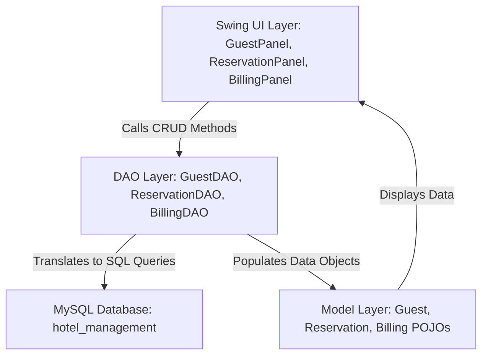
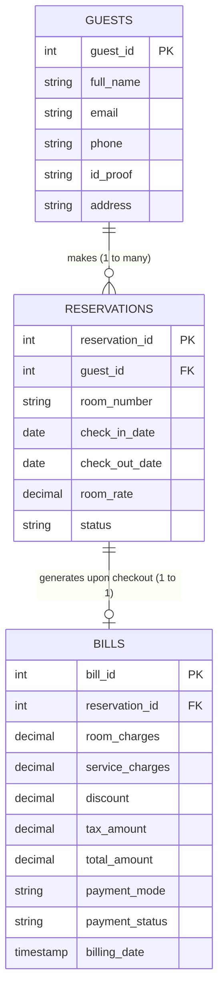

# HOTEL MANAGEMENT SYSTEM — MEMBER 2 VIVA & PROJECT GUIDE
## Module: Reservations, Guests & Billing

---

## 1. Project Overview & Team Structure

In this 4-member Hotel Management System project, responsibilities are cleanly divided:

| Member | Assigned Module | Key Responsibilities | Integration Point with Member 2 |
| :--- | :--- | :--- | :--- |
| **Member 1** | Manager Dashboard & Core System | Room inventory, revenue reports, occupancy stats | Reads reservation counts & revenue from `ReservationDAO` and `BillingDAO` |
| **Member 2 (YOU)** | **Reservations, Guests & Billing** | **Guest registration, room bookings, check-in, checkout, invoice calculation** | **Core transaction hub connecting guests to rooms, services, and billing** |
| **Member 3** | Staff Operations & Hotel Services | Hotel amenities/food orders, staff roster | When generating bills, service charges can pull from Member 3's `hotel_services` |
| **Member 4** | Guest Experience & Premium UI | Main window styling, kiosk/guest portal | Can embed your `GuestPanel`, `ReservationPanel`, and `BillingPanel` into the master UI |

> **Guarantee of Zero Clashes:**
> Your code uses the exact same project architecture, package names (`model`, `dao`, `database`, `ui`), database connection (`DBConnection.java` targeting `hotel_management` on port `3306`), and UI styling (`UITheme.java`) as Member 3. Everything fits together like Lego blocks.

---

## 2. System Architecture (Explained for Beginners)

The project follows the standard **3-Tier / DAO (Data Access Object) Architecture**:



### Why this architecture is used:
1. **Separation of Concerns:** UI code handles buttons and textboxes; DAO handles SQL queries; Model handles data attributes.
2. **Maintainability:** If the database changes from MySQL to PostgreSQL, you only edit the DAO files — the UI doesn't break.
3. **Team Collaboration:** Member 4 can redesign the UI without touching your database logic.

---

## 3. Database Schema & Relationships

### Entity Relationship Diagram:



### Key Foreign Key Constraints:
- `reservations.guest_id` $\rightarrow$ `guests.guest_id` (If a guest is deleted, their bookings cascade or stay consistent).
- `bills.reservation_id` $\rightarrow$ `reservations.reservation_id` (Links each invoice directly to a stay).

---

## 4. Code Walkthrough (File by File)

### A. The Model Layer (`src/model/`)
Plain Old Java Objects (POJOs) with private fields and public getters/setters (OOP **Encapsulation**):
- [Guest.java](file:///c:/Users/DELL/OneDrive/Desktop/New%20folder%20(3)/src/model/Guest.java): Holds guest profile (`guestId`, `fullName`, `phone`, `email`, `idProof`, `address`).
- [Reservation.java](file:///c:/Users/DELL/OneDrive/Desktop/New%20folder%20(3)/src/model/Reservation.java): Holds booking details. Includes business helper methods:
  - `getNumberOfNights()`: Uses `java.time.temporal.ChronoUnit.DAYS` to calculate stay duration.
  - `calculateRoomTotal()`: Multiplies `nights * roomRate`.
- [Billing.java](file:///c:/Users/DELL/OneDrive/Desktop/New%20folder%20(3)/src/model/Billing.java): Holds invoice details (`roomCharges`, `serviceCharges`, `discount`, `taxAmount`, `totalAmount`, `paymentMode`).
  - `calculateTotal()`: Formula $\text{Total} = (\text{Room} + \text{Services} - \text{Discount}) \times (1 + \text{TaxRate})$.

### B. The Database Layer (`src/database/`)
- [DBConnection.java](file:///c:/Users/DELL/OneDrive/Desktop/New%20folder%20(3)/src/database/DBConnection.java): Centralized connection factory using JDBC `DriverManager.getConnection()`. Loads `com.mysql.cj.jdbc.Driver`.
- [DatabaseSetup.java](file:///c:/Users/DELL/OneDrive/Desktop/New%20folder%20(3)/src/database/DatabaseSetup.java): **Automated setup tool**. Running this class creates the database `hotel_management`, builds all tables, and seeds sample records automatically.

### C. The DAO Layer (`src/dao/`)
Performs SQL queries safely using `PreparedStatement` to prevent SQL Injection:
- [GuestDAO.java](file:///c:/Users/DELL/OneDrive/Desktop/New%20folder%20(3)/src/dao/GuestDAO.java):
  - `addGuest(Guest)`: Inserts guest and retrieves auto-generated `guest_id`.
  - `getAllGuests()`: Returns `List<Guest>`.
  - `updateGuest(Guest)`: Updates existing guest.
  - `deleteGuest(int)`: Removes guest record.
- [ReservationDAO.java](file:///c:/Users/DELL/OneDrive/Desktop/New%20folder%20(3)/src/dao/ReservationDAO.java):
  - `addReservation(Reservation)`: Books a room.
  - `getAllReservations()`: Performs SQL `JOIN` with `guests` to display guest names on the table.
  - `updateStatus(int, String)`: Changes status (e.g. to `CHECKED_IN`, `CHECKED_OUT`, `CANCELLED`).
  - `getActiveReservations()`: Pulls active bookings eligible for checkout.
- [BillingDAO.java](file:///c:/Users/DELL/OneDrive/Desktop/New%20folder%20(3)/src/dao/BillingDAO.java):
  - `createBill(Billing)`: **Uses Database Transactions (`setAutoCommit(false)`)**. In one atomic operation, inserts the bill and automatically updates the reservation status to `CHECKED_OUT`.
  - `getAllBills()`: Retrieves billing history with guest name and room number.

### D. The UI Layer (`src/ui/`)
Built with Java Swing, styled identically to Member 3:
- [UITheme.java](file:///c:/Users/DELL/OneDrive/Desktop/New%20folder%20(3)/src/ui/UITheme.java): Central styling constant file (Segoe UI fonts, Navy `#1E3A5F`, Teal `#166574`, Red `#C94A4A`, custom table headers).
- [GuestPanel.java](file:///c:/Users/DELL/OneDrive/Desktop/New%20folder%20(3)/src/ui/GuestPanel.java): 2-column card form, full guest table, validation, and Add/Update/Delete actions.
- [ReservationPanel.java](file:///c:/Users/DELL/OneDrive/Desktop/New%20folder%20(3)/src/ui/ReservationPanel.java): Guest dropdown, room picker, automatic rate lookup, check-in button, and cancellation dialog.
- [BillingPanel.java](file:///c:/Users/DELL/OneDrive/Desktop/New%20folder%20(3)/src/ui/BillingPanel.java): Active reservation dropdown, auto-computed room charges (`nights * rate`), GST calculator, Checkout button, and **Printable Receipt Popup Dialog**.

### E. Main Entry Point (`src/Main.java`)
Mounts the three panels into a clean `JTabbedPane`:
1. `Guest Management`
2. `Room Reservations`
3. `Billing & Checkout`

When tabs are switched, data automatically refreshes so newly added guests immediately appear in the reservation dropdown!

---

## 5. How to Run the Project

### Option 1: In VS Code (Recommended)
1. Ensure your MySQL server (via XAMPP or MySQL Workbench) is running.
2. If tables don't exist yet, right click [DatabaseSetup.java](file:///c:/Users/DELL/OneDrive/Desktop/New%20folder%20(3)/src/database/DatabaseSetup.java) and click **Run Java**.
3. Right click [Main.java](file:///c:/Users/DELL/OneDrive/Desktop/New%20folder%20(3)/src/Main.java) and click **Run Java**.

### Option 2: Via Terminal / Command Prompt
```bash
# 1. Compile all Java source files
javac -cp "lib/*" -d bin src/database/*.java src/model/*.java src/dao/*.java src/ui/*.java src/Main.java

# 2. Run Database Setup (only needed once)
java -cp "bin;lib/*" database.DatabaseSetup

# 3. Launch Application
java -cp "bin;lib/*" Main
```

---

## 6. Top 20 Viva Questions & Model Answers

### Q1: What is the scope of your module (Member 2)?
**Answer:** "My module handles **Reservations, Guests, and Billing**. It allows registering guests with ID proofs, booking rooms with date ranges, managing check-ins, calculating stay charges with taxes/discounts, and generating checkout invoices."

### Q2: What is JDBC and what steps are involved in connecting to a database?
**Answer:** "JDBC stands for Java Database Connectivity. The steps are:
1. Load JDBC Driver: `Class.forName("com.mysql.cj.jdbc.Driver")`
2. Establish Connection: `DriverManager.getConnection(url, user, password)`
3. Create Statement / PreparedStatement
4. Execute SQL Query: `executeQuery()` for SELECT, `executeUpdate()` for INSERT/UPDATE/DELETE
5. Process ResultSet
6. Close Connection (handled automatically using try-with-resources)."

### Q3: Why did you use `PreparedStatement` instead of regular `Statement`?
**Answer:**
1. **Security:** It prevents **SQL Injection** attacks because input parameters are parameterized with `?` placeholders.
2. **Performance:** PreparedStatement is pre-compiled by the database engine for faster repetitive execution.
3. **Data Types:** It cleanly handles date, decimal, and string escaping automatically.

### Q4: What is the DAO pattern and why is it beneficial?
**Answer:** "DAO stands for Data Access Object. It separates the business/UI logic from database access logic. If we change the database or table queries, we only modify the DAO class, keeping our Swing UI completely untouched."

### Q5: What OOP concepts did you implement in this project?
**Answer:**
- **Encapsulation:** Model classes (`Guest`, `Reservation`, `Billing`) have private instance variables accessible only through public getters and setters.
- **Inheritance:** Our UI panels extend `JPanel` (`public class GuestPanel extends JPanel`).
- **Polymorphism:** Method overriding, such as `@Override toString()` in Model classes and overriding `isCellEditable()` in `DefaultTableModel`.
- **Abstraction:** The UI interacts with high-level DAO methods (`addGuest`, `createBill`) without knowing internal SQL execution details.

### Q6: How does the billing calculation work?
**Answer:**
1. Nights stayed = `ChronoUnit.DAYS.between(checkInDate, checkOutDate)`.
2. Room Charges = `nights * roomRatePerNight`.
3. Subtotal = `Room Charges + Service Charges - Discount`.
4. Tax Amount = `Subtotal * (TaxRate% / 100)`.
5. Total Bill = `Subtotal + Tax Amount`.

### Q7: What happens when a guest checks out in your system?
**Answer:** "When the 'Generate Bill & Checkout' button is clicked:
1. A transaction begins in `BillingDAO`.
2. The bill record is inserted into the `bills` table.
3. The reservation status is updated from `CHECKED_IN` to `CHECKED_OUT`.
4. If both succeed, the transaction is committed; if an error occurs, it rolls back.
5. A printable invoice receipt dialog is popped up on screen."

### Q8: What is a Database Transaction and why did you use `setAutoCommit(false)`?
**Answer:** "A transaction ensures **ACID properties (Atomicity, Consistency, Isolation, Durability)**. During checkout, we must both save the bill AND update the reservation status. If bill creation succeeds but updating reservation status fails, data becomes inconsistent. Using `con.setAutoCommit(false)`, `con.commit()`, and `con.rollback()`, either both succeed or neither does."

### Q9: Why did you use `BigDecimal` instead of `double` or `float` for prices and totals?
**Answer:** "`double` and `float` use binary floating-point representation which causes rounding errors in currency (e.g. `0.1 + 0.2 = 0.30000000000000004`). In financial/billing applications, `BigDecimal` guarantees exact decimal precision."

### Q10: How does your module integrate with Member 3 (Hotel Services)?
**Answer:** "Member 3 manages hotel services (like Food, Laundry, Spa) in the `hotel_services` table. In our `BillingPanel`, we have a dedicated `Service Charges` field. When a guest orders room service, that total is added to their stay invoice."

### Q11: How does your module integrate with Member 1 (Manager Dashboard)?
**Answer:** "Member 1 can call `ReservationDAO.getAllReservations()` to count occupied rooms, occupancy rate, and upcoming bookings, and `BillingDAO.getAllBills()` to compute total hotel revenue."

### Q12: How does your module integrate with Member 4 (Premium UI)?
**Answer:** "Because each of our features is encapsulated in a separate `JPanel` (`GuestPanel`, `ReservationPanel`, `BillingPanel`), Member 4 can seamlessly mount our panels as tabs inside their master window with a single line of code (`tabs.addTab(...)`)."

### Q13: What is `SwingUtilities.invokeLater()` in `Main.java`?
**Answer:** "Swing components are not thread-safe and must be created and updated on the **Event Dispatch Thread (EDT)**. `SwingUtilities.invokeLater()` schedules the GUI initialization task on the EDT to prevent UI freezing or race conditions."

### Q14: How do you handle input validation?
**Answer:** "Before executing database operations, the `readForm()` methods check for empty strings, invalid date orders (e.g., checkout before checkin), negative prices, and invalid number formats, throwing informative `IllegalArgumentException` messages displayed via `JOptionPane`."

### Q15: What is `try-with-resources`?
**Answer:** "Introduced in Java 7, `try (Connection con = ...; PreparedStatement ps = ...)` automatically closes resources implementing `AutoCloseable` when the block exits, preventing database connection leaks even if an exception is thrown."

---

## 7. Viva Demonstration Checklist

When presenting to your professor/evaluator:
1. **Show the UI:** Open `Main.java`, point out the clean Segoe UI typography, matching palette, and structured card layout.
2. **Tab 1 (Guests):** Fill out a new guest form, click **Add Guest**. Notice the auto-generated ID appear in the table.
3. **Tab 2 (Reservations):** Switch to Reservations. Select the newly registered guest from the dropdown, pick room 201, click **Book Room**. Select the row and click **Check-In Guest**.
4. **Tab 3 (Billing & Checkout):** Select the booking, show how Room Charges are auto-calculated from nights and rate. Enter ₹300 services and a discount, select 18% GST. Click **Generate Bill & Checkout**.
5. **Show Receipt:** Walk through the formatted ASCII receipt dialog displayed on screen.
6. **Show Clean Architecture:** Explain how `Guest.java` (Model) $\rightarrow$ `GuestDAO.java` (Database query) $\rightarrow$ `GuestPanel.java` (UI) cooperate cleanly.
